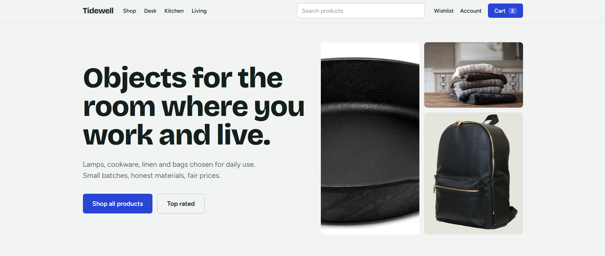
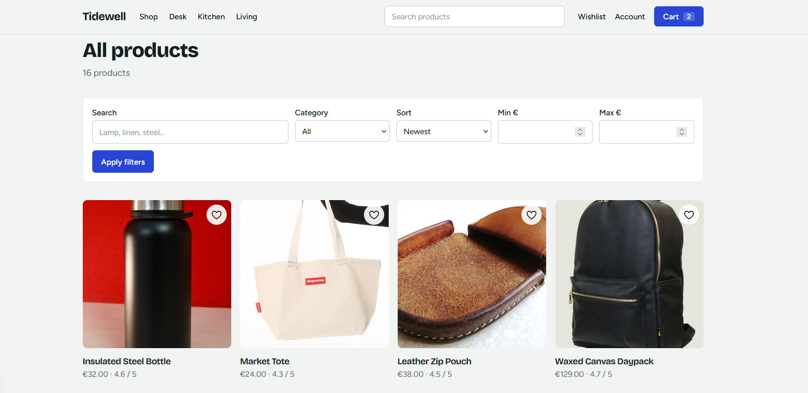
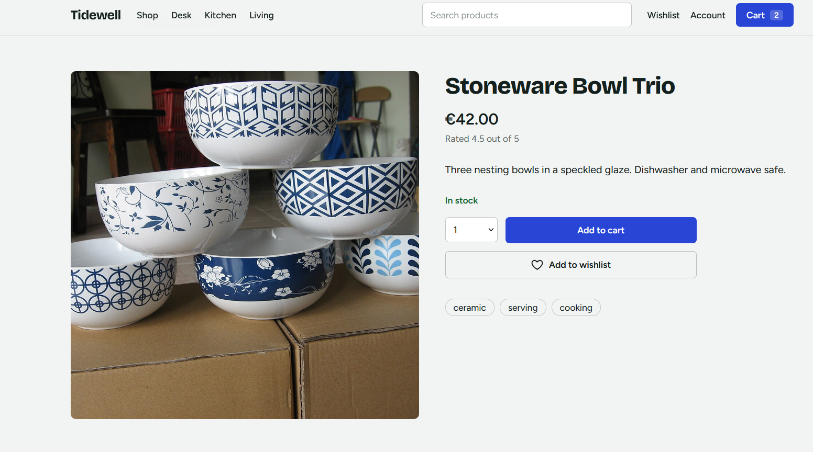
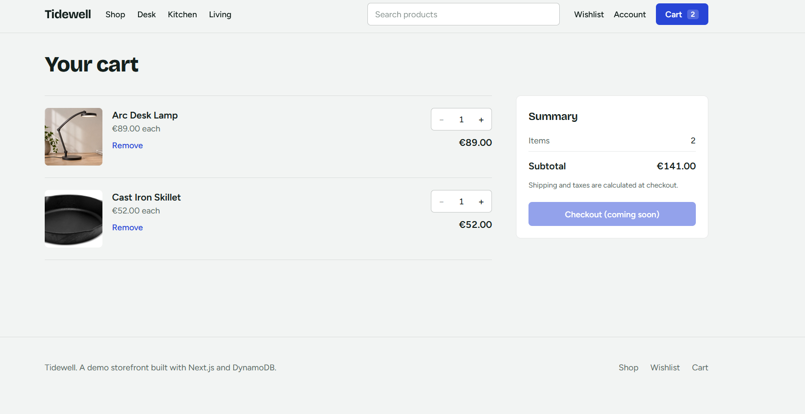
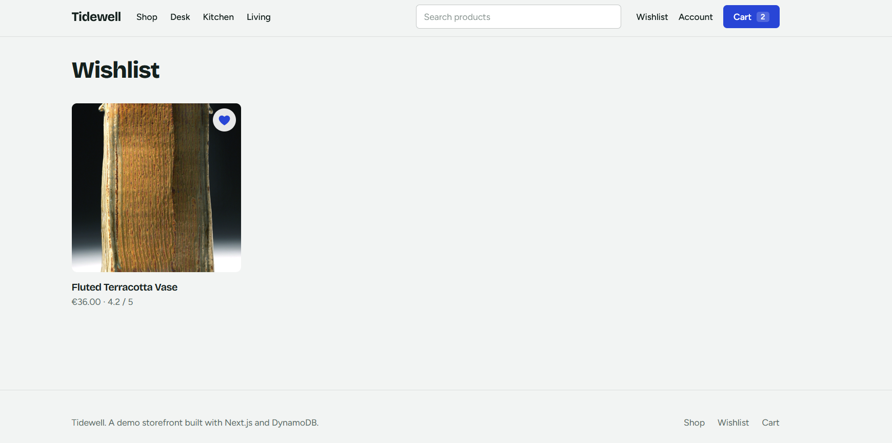
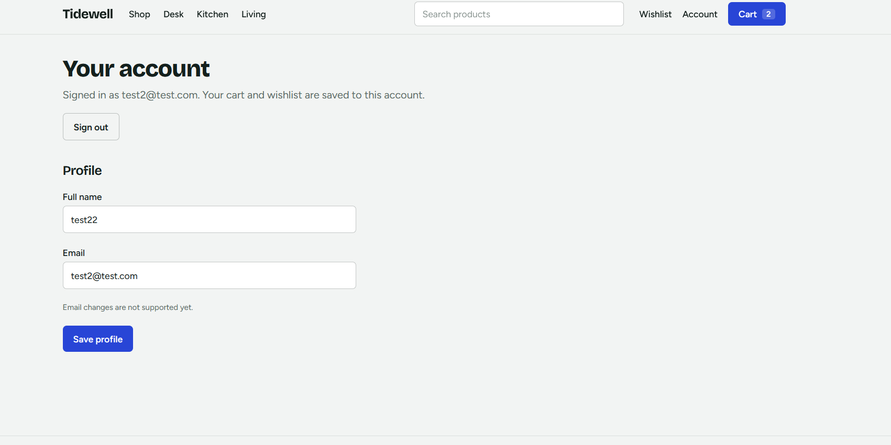
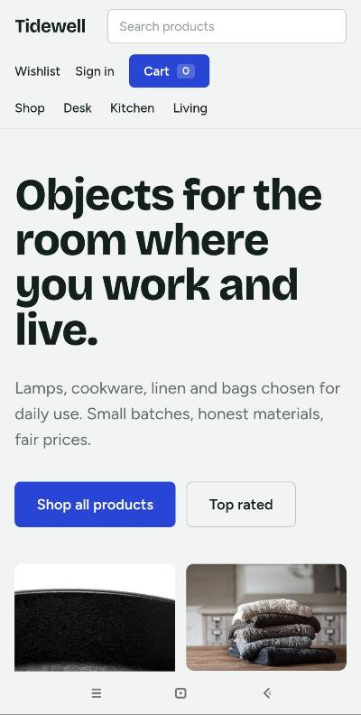

# Tidewell

Tidewell is a full-stack e-commerce application built for a software engineering internship project. It is a small demonstration store with 16 products in four categories: Desk & Studio, Kitchen, Living, and Carry.

The project focuses on how the store works behind the interface: products come from DynamoDB, cart and wishlist changes are handled on the server, and registered users can return to their saved data. The application runs locally with Next.js and DynamoDB Local in Docker.

**Repository:** https://github.com/hristiko/tynoch-tech-ecommerce-app

## 1. Project Overview

Tidewell lets visitors browse products, search and filter the catalogue, save items to a wishlist, and manage a shopping cart. Customers can use the store as guests or create accounts to keep their profile, cart, and wishlist across sessions.

The project implements the storefront, API, business logic, and database layers. It does not process payments or place orders. The checkout button is intentionally inactive because checkout is outside the assignment's scope.

## 2. Features

### Product catalogue

- Responsive homepage and product listings for desktop and mobile.
- Four categories, product details, stock information, and related items.
- Search by product name or tags; filter by category and price; sort results.
- Locally stored product and category images.
- Loading indicators, empty states, form validation, helpful errors, and a custom 404 page.

### Cart and wishlist

- Add and remove products, update cart quantities, and calculate subtotals.
- Apply stock limits and maximum quantities per product.
- Keep one cart line per product and prevent duplicate wishlist entries.
- Use conditional DynamoDB updates to avoid losing changes when two requests modify the same cart item at once.
- Preserve guest shopping data and import eligible items after sign-in.

### Accounts

- Register with an email and password; sign in and sign out.
- Store passwords as salted `scrypt` hashes, not plaintext.
- Keep each registered user's profile, cart, and wishlist separate.
- Restore saved shopping data after signing in again.
- Apply rate limits to registration and login attempts.

## 3. Tech Stack

| Area | Technology |
| --- | --- |
| Frontend | Next.js 16 (App Router), React 19, TypeScript |
| Backend | Next.js Route Handlers and server-side services |
| Database | AWS DynamoDB; DynamoDB Local in Docker for development |
| Authentication | NextAuth.js v4 (credentials provider) |
| Styling | Tailwind CSS |
| Validation | Zod 4 |
| Testing | Vitest 5, DynamoDB Local integration checks, HTTP API checks |
| Version control | Git and GitHub |

## 4. Project Structure

```
src/
  app/                   Pages, loading/error pages, and API routes
  components/            Reusable React components
  services/              Catalogue, cart, wishlist, and account logic
  db/                    DynamoDB client and repositories
  lib/                   Authentication, validation, and shared helpers
  types/                 Shared TypeScript types
scripts/                 Database setup, seeding, and integration checks
tests/                   Unit tests
public/images/           Product and category images
docs/                    Technical guides, credits, and screenshots
compose.yaml             Persistent DynamoDB Local configuration
.env.example             Example environment settings
```

## 5. Architecture

The frontend displays products and collects user actions. Browser requests go to Next.js API routes, which validate inputs and call services. Services apply the shopping rules and use repository functions to read or update DynamoDB. Server-rendered pages can call services directly.

```
Browser / React interface
           |
           v
Next.js pages and API routes
           |
           v
Services (catalogue, cart, wishlist, accounts)
           |
           v
DynamoDB repositories
           |
           v
DynamoDB
```

For example, when a customer adds a product to the cart, the backend checks the product and requested quantity, updates the correct user's cart record, and returns the recalculated cart. Conditional writes and retries protect against overlapping updates.

### Main API endpoints

| Method | Endpoint | Purpose |
| --- | --- | --- |
| `GET` | `/api/products` | List, search, filter, and sort products |
| `GET` | `/api/products/[id]` | Get product details |
| `GET` | `/api/categories` | List categories |
| `GET`, `POST` | `/api/cart` | View the cart or add an item |
| `PATCH`, `DELETE` | `/api/cart/[productId]` | Change quantity or remove an item |
| `GET`, `POST` | `/api/wishlist` | View or add saved items |
| `DELETE` | `/api/wishlist/[productId]` | Remove a saved item |
| `GET`, `PUT` | `/api/user` | View or update the current profile |
| `POST` | `/api/auth/register` | Register an account |
| NextAuth | `/api/auth/[...nextauth]` | Sign-in, sessions, and sign-out |
| `POST` | `/api/account/import-guest` | Import eligible guest shopping data |

The server determines account ownership from the authenticated session, not from a user ID provided by the browser.

## 6. DynamoDB Setup

Tidewell uses one DynamoDB table, called `tidewell-store` by default. Records have a partition key (`PK`) and sort key (`SK`), and secondary indexes support product and category queries.

| Record | Example keys | Stored information |
| --- | --- | --- |
| Product | `PRODUCT#id` / `METADATA` | Name, description, price, stock, image paths |
| Category | `CATEGORY#slug` / `METADATA` | Category name and image |
| Profile | `USER#id` / `PROFILE` | Name and email |
| Credentials | `USER#acct-id` / `CREDENTIALS` | Salted password hash |
| Email lookup | `AUTH_EMAIL#hash` / `LOOKUP` | Unique email-to-account mapping |
| Cart item | `USER#id` / `CART#productId` | Quantity and update version |
| Wishlist item | `USER#id` / `WISHLIST#productId` | Saved product |
| Rate-limit counter | `RATE#scope#hash` / `WINDOW#number` | Authentication attempt count |

The supplied `compose.yaml` starts DynamoDB Local with a persistent Docker volume. This keeps database records after a container or computer restart. The database still runs locally and is not publicly hosted.

For a **new installation**, create the table and load the sample catalogue using `npm run db:create` and `npm run db:seed`, as shown below. Do not reseed an existing database simply to start the application: seeding can overwrite existing product data.

For volume permissions, startup and shutdown details, see [Local DynamoDB setup](docs/LOCAL_DYNAMODB.md).

## 7. Environment Variables

Create `.env.local` from `.env.example`. For local development, use:

```dotenv
AWS_REGION=eu-central-1
AWS_ACCESS_KEY_ID=local
AWS_SECRET_ACCESS_KEY=local
DYNAMODB_TABLE_NAME=tidewell-store
DYNAMODB_ENDPOINT=http://localhost:8000
NEXTAUTH_URL=http://localhost:3000
NEXTAUTH_SECRET=REPLACE_WITH_YOUR_GENERATED_SECRET
AUTH_TRUST_PROXY=false
```

The AWS credentials above are dummy credentials for DynamoDB Local. Generate a separate random NextAuth secret:

```powershell
node -e "console.log(require('node:crypto').randomBytes(32).toString('base64'))"
```

Paste the generated value into `NEXTAUTH_SECRET`. Do not commit `.env.local` or real credentials. Leave `AUTH_TRUST_PROXY=false` for this local setup.

## 8. Installation Instructions

These instructions use Windows PowerShell. You need **Node.js 22.12 or newer**, npm, Git, and Docker Desktop with Docker Compose.

### Step 1: Download the project

```powershell
git clone https://github.com/hristiko/tynoch-tech-ecommerce-app.git
cd tynoch-tech-ecommerce-app
npm ci
```

### Step 2: Configure the environment

```powershell
Copy-Item .env.example .env.local
```

Edit `.env.local` with the values in Section 7 and generate `NEXTAUTH_SECRET`.

### Step 3: Start DynamoDB Local

On a new computer, run:

```powershell
docker compose up -d
```

If you already have the working `tidewell-dynamodb` container, do not start a second database on port 8000. Start the existing container instead:

```powershell
docker start tidewell-dynamodb
```

### Step 4: Initialize a new database

Run these commands **only if the database is empty and has not been initialized**:

```powershell
npm run db:create
npm run db:seed
```

### Step 5: Start the application

```powershell
npm run dev
```

Open **http://localhost:3000**.

To check a production build locally:

```powershell
npm run build
npm run start
```

**Persistence:** The Docker volume survives normal restarts, but it is not a backup. Do not use `docker compose down -v` if you want to retain your data. The application is not publicly deployed.

## 9. Authentication and Security

Registered users authenticate through NextAuth. Their passwords are hashed with `scrypt` and a random salt. Guest visitors use a signed cookie, and the backend checks account ownership before returning profile, cart, or wishlist data. Authentication attempts are rate-limited using DynamoDB.

See the detailed guides for [authentication](docs/AUTHENTICATION.md), [rate limiting](docs/AUTH_RATE_LIMITING.md), [guest sessions](docs/GUEST_SESSION_SECURITY.md), and [cart consistency](docs/CART_CONSISTENCY.md).

This is an internship demonstration rather than a fully operated public service. It does not include email verification, password recovery, multi-factor authentication, or production monitoring.

## 10. Testing

Run the standard checks from the project directory:

```powershell
npm run typecheck
npm test
npm run lint
npm run build
npm audit
```

With DynamoDB Local running, check database behavior:

```powershell
npm run db:test-cart
npx tsx scripts/check-auth-rate-limit.ts
```

For HTTP account-isolation tests, keep both DynamoDB and Next.js running, then use a second terminal:

```powershell
node --env-file=.env.local scripts/check-api-isolation.mjs
```

The integration script creates temporary accounts to verify registration, login, cart and wishlist isolation, profile ownership, request validation, and logout. It cleans up the records it creates and refuses to run against a non-local database endpoint.

## 11. Screenshots

The images below refer to screenshots captured from the locally running application. Add these files to `docs/screenshots/` before submitting.

### Homepage



### Product listing and filters



### Product details



### Shopping cart



### Wishlist



### Account page



### Mobile layout



## 12. Product Images

Product and category images are stored in `public/images/` and referenced in DynamoDB. They illustrate the sample catalogue rather than particular manufacturer listings. Image sources and usage notes are documented in [Product images](docs/PRODUCT_IMAGES.md), with attribution in [Image credits](docs/IMAGE_CREDITS.md).

For an already populated database, use the image-only updater instead of reseeding:

```powershell
node --env-file=.env.local scripts/update-catalog-images.mjs
node --env-file=.env.local scripts/update-catalog-images.mjs --apply
```

The first command checks the files and matching records without making changes; the second updates the image references.

## 13. Known Limitations and Submission

Tidewell does not process payments, place orders, calculate shipping, or reserve inventory for checkout. Search and price filtering are suitable for the small sample catalogue, but would need a different design for a much larger product database.

A live project URL is optional because the application has not been deployed.