# Tidewell — E-Commerce Storefront and Admin Dashboard

Tidewell is a full-stack e-commerce internship project consisting of **two locally running Next.js applications**: a customer storefront and a separate administration dashboard. Both applications connect to the **same DynamoDB Local database**, so changes made in one application are reflected in the other.

The sample catalogue contains 16 products across four categories: **Desk & Studio, Kitchen, Living, and Carry**. The admin dashboard also includes historical **synthetic order data** for demonstrating sales analytics. The storefront does not process real orders or payments.

**Repository:** https://github.com/hristiko/tynoch-tech-ecommerce-app

| Application | Local URL | Purpose |
| --- | --- | --- |
| Customer storefront | http://localhost:3000 | Browse products, manage an account, cart and wishlist |
| Admin dashboard | http://localhost:3001 | View statistics and manage products, categories, users and shopping records |
| DynamoDB Local | http://localhost:8000 | Shared database running in Docker |

**Deployment status:** Neither website is publicly deployed. The project runs locally using Docker Desktop and Node.js; no cloud database or hosting account is required.

## 1. Project Overview

The customer-facing application allows guests and registered users to browse the catalogue, find products, save items and manage a shopping cart. Registered users can return to their saved cart, wishlist and profile.

The administration application has its own login page at `/login` on port 3001. Administrators can inspect the current store data, update the catalogue, manage customer accounts and shopping records, and review sales charts generated from demo orders.

The applications have **separate Next.js servers, API routes and authentication sessions**, but share the same DynamoDB table. Administrator access is enforced by the backend using an explicit role stored in DynamoDB; it does not depend on hiding a navigation link or knowing an obscure URL.

## 2. Features

### Customer storefront

- Responsive homepage, catalogue, category navigation and product detail pages.
- Product search, category and price filters, sorting, stock information and related products.
- Cart operations: add items, change quantities, remove products and calculate subtotals.
- Wishlist operations with duplicate prevention.
- Guest shopping sessions and importing eligible guest items after sign-in.
- Customer registration, login, logout and display-name editing.
- Loading, empty, error and not-found states, with input validation.

### Admin dashboard

- **Overview:** current counts of registered users, products, categories, cart lines and wishlist lines.
- **Sales analytics:** completed-order revenue, order counts, average order value, monthly revenue, order-status distribution, top-selling products and recent orders.
- **Sales source filter:** show all orders, demo orders or storefront orders separately.
- **Products:** search, filter, paginate, create, edit, delete and change price or stock.
- **Categories:** list, search, create, edit and delete categories.
- **Users:** inspect registered accounts, search, filter by role, update display names and delete eligible customer accounts.
- **Carts and wishlists:** inspect items belonging to registered users and guests, and remove individual items with confirmation.
- Confirmation prompts for destructive operations, concurrency checks, validation and loading/empty/error states.
- Automatic refresh of dashboard data, approximately every 15 seconds, and manual refresh where available.

**Data protection rules:** Products referenced by existing carts or wishlists cannot be deleted. Categories containing products cannot be deleted. Admin accounts cannot be deleted through customer management. Email addresses and administrator roles cannot be changed through the admin forms.

## 3. Tech Stack

| Layer | Technology |
| --- | --- |
| Customer and admin interfaces | Next.js 16 (App Router), React 19, TypeScript |
| Styling | Tailwind CSS |
| Server-side APIs | Next.js Route Handlers |
| Database | DynamoDB Local (AWS DynamoDB-compatible API) |
| Database client | AWS SDK for JavaScript v3 |
| Authentication | NextAuth.js v4, credentials provider, separate sessions for both applications |
| Password storage | Salted `scrypt` password hashes |
| Storefront validation | Zod 4 |
| Admin validation | Server-side input validation and business-rule checks |
| Testing | Vitest (storefront), Node.js test runner (admin), DynamoDB and HTTP integration scripts |
| Development tools | Node.js, npm, Docker Desktop, Docker Compose, Git and GitHub |

## 4. Project Structure

```text
.
├── src/                       Customer storefront
│   ├── app/                   Storefront pages and API routes
│   ├── components/            Reusable React components
│   ├── services/              Catalogue, cart, wishlist and account rules
│   ├── db/                    DynamoDB repositories
│   ├── lib/                   Sessions, validation and helpers
│   └── types/                 Shared storefront types
├── admin/                     Separate Next.js admin application
│   ├── src/
│   │   ├── app/               Admin pages and protected API routes
│   │   ├── components/        Dashboard, forms and management tables
│   │   ├── lib/               Admin authorization, models and database operations
│   │   └── types/             Admin application types
│   ├── scripts/               Admin role, demo sales and integration checks
│   ├── tests/                 Admin unit tests
│   ├── .env.example           Admin environment template
│   └── package.json           Admin dependencies and commands
├── scripts/                   Storefront database setup, seed and tests
├── tests/                     Storefront unit tests
├── public/images/             Local product and category images
├── docs/                      Technical guides, credits and screenshots
├── compose.yaml               Persistent DynamoDB Local container
├── .env.example               Storefront environment template
├── package.json               Storefront dependencies and commands
└── README.md
```

The root directory and `admin/` each have their own `package.json` and `package-lock.json`. Install and run them separately.

## 5. Architecture

```text
            CUSTOMER STOREFRONT                  ADMIN DASHBOARD
             localhost:3000                       localhost:3001
                    |                                   |
          Storefront Next.js app                Admin Next.js app
          Pages + customer APIs                 Pages + admin APIs
                    |                                   |
          Services / repositories             Admin authorization,
                    |                         validation and data access
                    |                                   |
                    +----------------+------------------+
                                     |
                                     v
                        Shared DynamoDB Local
                          localhost:8000
                         Table: tidewell-store
```

The two applications are separate Next.js projects, not separate databases. They access the same records using compatible DynamoDB keys and indexes.

For example, when an administrator updates a product's price or stock, the change is written to DynamoDB. The storefront reads the updated product when its page or listing refreshes. Similarly, when a customer adds an item to their cart or wishlist, the admin shopping pages can read that record after refresh or the next polling interval.

The dashboard is **near-real-time**, rather than a live WebSocket feed. Admin pages poll approximately every 15 seconds. Newly written catalogue records accessed through DynamoDB secondary indexes can require a brief delay before appearing.

### Authorization

Customer and administrator sessions use separate NextAuth configurations and distinct cookies. Normal customer registration does **not** create an administrator. Admin login and protected admin API requests verify the account's current `admin` role in DynamoDB. Administrator permissions are checked server-side, including for write operations.

## 6. DynamoDB Setup

Tidewell uses a single table named `tidewell-store` by default. Every record has a partition key (`PK`) and sort key (`SK`). Secondary indexes support catalogue listings and demo order queries.

| Data | Example keys | Purpose |
| --- | --- | --- |
| Product | `PRODUCT#id` / `METADATA` | Product information, price, stock and image paths |
| Category | `CATEGORY#slug` / `METADATA` | Category details |
| User profile | `USER#id` / `PROFILE` | Name, email, account type and admin role when applicable |
| Login credentials | `USER#acct-id` / `CREDENTIALS` | Password hash |
| Email lookup | `AUTH_EMAIL#hash` / `LOOKUP` | Unique email-to-account lookup |
| Cart item | `USER#id` / `CART#productId` | Quantity and revision information |
| Wishlist item | `USER#id` / `WISHLIST#productId` | Saved product |
| Demo order | `ORDER#id` / `METADATA` | Order status, timestamp, line-item price snapshots and totals |
| Rate-limit record | `RATE#...` or `ADMIN_RATE#...` | Storefront/admin authentication attempt tracking |

### Start the local database

Start Docker Desktop. For a **new installation**, run from the repository root:

```powershell
docker compose up -d
```

The included `compose.yaml` uses a persistent Docker volume called `tidewell-dynamodb-data`. Database records survive normal container and computer restarts.

If you already have a working container named `tidewell-dynamodb`, start that existing container instead of creating another container on port 8000:

```powershell
docker start tidewell-dynamodb
```

Initialize **only a new, empty database**:

```powershell
npm run db:create
npm run db:seed
```

The seed adds the sample product catalogue and categories. **Do not rerun `db:seed` on a populated database** to restart the app or refresh images; it can overwrite catalogue records.

To populate historical synthetic sales separately, use the admin seed command described in Section 8. It does not change products, accounts, stock, carts or wishlists.

**Do not use `docker compose down -v`** if you need to retain your database. The volume is persistent storage, but it is not a backup. More details are in [Local DynamoDB setup](docs/LOCAL_DYNAMODB.md).

## 7. Environment Variables

Both applications need their **own** `.env.local` file and **different** `NEXTAUTH_SECRET` values. They must point to the same DynamoDB endpoint and table.

### Storefront — `.env.local` in the repository root

```dotenv
AWS_REGION=eu-central-1
AWS_ACCESS_KEY_ID=local
AWS_SECRET_ACCESS_KEY=local
DYNAMODB_TABLE_NAME=tidewell-store
DYNAMODB_ENDPOINT=http://localhost:8000
NEXTAUTH_URL=http://localhost:3000
NEXTAUTH_SECRET=REPLACE_WITH_STOREFRONT_SECRET
AUTH_TRUST_PROXY=false
```

### Admin — `admin/.env.local`

```dotenv
AWS_REGION=eu-central-1
AWS_ACCESS_KEY_ID=local
AWS_SECRET_ACCESS_KEY=local
DYNAMODB_TABLE_NAME=tidewell-store
DYNAMODB_ENDPOINT=http://localhost:8000
NEXTAUTH_URL=http://localhost:3001
NEXTAUTH_SECRET=REPLACE_WITH_DIFFERENT_ADMIN_SECRET
```

Generate a secret using:

```powershell
node -e "console.log(require('node:crypto').randomBytes(32).toString('base64'))"
```

Run this command twice and copy a different result into each file. The `local` AWS credentials above are placeholders accepted by DynamoDB Local, **not real AWS credentials**. Never commit `.env.local`, passwords or secrets.

## 8. Installation Instructions

These steps use Windows PowerShell. Requirements: **Node.js 22.12 or newer**, npm, Git and Docker Desktop with Docker Compose.

### Step 1 — Clone and install both applications

From a terminal:

```powershell
git clone https://github.com/hristiko/tynoch-tech-ecommerce-app.git
cd tynoch-tech-ecommerce-app
npm ci
cd admin
npm ci
cd ..
```

### Step 2 — Create both environment files

From the repository root:

```powershell
Copy-Item .env.example .env.local
Copy-Item admin/.env.example admin/.env.local
```

Edit the two files using the values in Section 7 and give each application its own generated authentication secret.

### Step 3 — Start and initialize DynamoDB

Start Docker Desktop, then run:

```powershell
docker compose up -d
```

For a new, empty table only:

```powershell
npm run db:create
npm run db:seed
```

If you're using an already-populated local database, skip the creation and seed commands.

### Step 4 — Start the storefront

In a terminal at the repository root:

```powershell
npm run dev
```

Open **http://localhost:3000**.

### Step 5 — Create and authorize an administrator

Create a normal registered account through the storefront's Account page, unless you already have one. Then, from a **second terminal in the repository root**, grant that account administrator access:

```powershell
node --env-file=.env.local admin/scripts/grant-admin.mjs your-email@example.com GRANT
```

Replace `your-email@example.com` with the registered account's actual email. The command explicitly requires `GRANT`. It adds the administrator role without changing the account's password, cart or wishlist.

**Administrator roles cannot be assigned from the web interface.** Only grant the role to an account you intend to use for administration.

### Step 6 — Start the admin dashboard

In another terminal:

```powershell
cd admin
npm run dev
```

Open **http://localhost:3001/login** and sign in with the promoted account's existing email and password.

### Step 7 — Add demo sales data (optional)

In the `admin/` directory, preview the 300 historical demo orders:

```powershell
npm run db:seed-sales
```

To insert them into DynamoDB:

```powershell
npm run db:seed-sales -- --apply
```

The seed is designed to be repeatable without duplicating orders: it uses a marker in DynamoDB to detect an existing completed demo dataset. It populates sales charts without implementing checkout, creating registered users or reducing inventory. **Skip this step if your local database already contains the demo orders.**

### Step 8 — Open both applications

| Storefront | Admin dashboard |
| --- | --- |
| http://localhost:3000 | http://localhost:3001 |

Keep both Next.js servers and DynamoDB Local running. No public hosting or cloud resources are used.

For a local production-style run, use `npm run build` followed by `npm run start` **separately** in the repository root and `admin/`.

## 9. Admin Dashboard Modules

| Page (on `localhost:3001`) | Available operations |
| --- | --- |
| `/` | Dashboard KPIs and demo sales analytics |
| `/products` | Product CRUD, price/stock changes, search, filters and pagination |
| `/categories` | Category CRUD and product-dependency checks |
| `/users` | Registered-user listing, details, name editing and eligible customer deletion |
| `/carts` | View registered/guest carts and remove individual items |
| `/wishlists` | View registered/guest wishlists and remove individual items |
| `/login` | Dedicated administrator sign-in |

Editing and deletion use server-side validation. Product and customer changes use revision checks so that outdated forms do not silently overwrite newer data. Destructive actions require confirmation.

User management does **not** reveal password hashes. Customer deletion removes related authentication and shopping records, but prevents deletion of admins and accounts that fail safety checks. A storefront session from a deleted account is not permitted to recreate that account.

## 10. Demo Sales and Statistics

The admin sales dashboard reads order records stored in DynamoDB. For an initialized demo dataset, the generator creates **300 synthetic orders over six months**. Orders can be `completed`, `pending` or `cancelled`, and they are tagged with `source: "demo"`.

The dashboard calculates:

- Total order count and orders by status.
- Revenue and average order value from **completed orders only**.
- Monthly revenue trend, best-selling products and recent orders.
- Live counts of registered users, products, categories, cart lines and wishlist lines.

Order line items preserve historical product names, prices and quantities, so editing a product's current price does not rewrite historical demo revenue.

**These orders are demonstration data, not actual customer purchases.** The storefront checkout is inactive and cannot create orders. Therefore, selecting the *Storefront* sales source currently shows zero orders. Cart and wishlist changes update shopping statistics, not revenue.

## 11. API Endpoints

### Storefront (port 3000)

| Method | Endpoint | Purpose |
| --- | --- | --- |
| `GET` | `/api/products`, `/api/products/[id]` | Browse and inspect products |
| `GET` | `/api/categories` | View categories |
| `GET`, `POST` | `/api/cart` | Read the cart or add an item |
| `PATCH`, `DELETE` | `/api/cart/[productId]` | Update a quantity or remove a product |
| `GET`, `POST` | `/api/wishlist` | Read or save wishlist items |
| `DELETE` | `/api/wishlist/[productId]` | Remove a saved product |
| `GET`, `PUT` | `/api/user` | View or edit the current profile |
| `POST` | `/api/auth/register` | Register an account |
| NextAuth | `/api/auth/[...nextauth]` | Customer sign-in and session handling |
| `POST` | `/api/account/import-guest` | Import eligible guest shopping data |

### Admin dashboard (port 3001)

| Method | Endpoint | Purpose |
| --- | --- | --- |
| `GET` | `/api/admin/overview` | Current database counts |
| `GET` | `/api/admin/sales?source=all` | Sales analytics; also accepts `demo` and `storefront` |
| `GET`, `POST` | `/api/admin/products` | List and create products |
| `PUT`, `DELETE` | `/api/admin/products/[id]` | Edit or delete a product |
| `GET`, `POST` | `/api/admin/categories` | List and create categories |
| `PUT`, `DELETE` | `/api/admin/categories/[slug]` | Edit or delete a category |
| `GET` | `/api/admin/users` | List registered users |
| `GET`, `PUT`, `DELETE` | `/api/admin/users/[id]` | Inspect, rename or delete an eligible customer |
| `GET` | `/api/admin/shopping` | List users/guests with shopping records |
| `GET` | `/api/admin/shopping/[id]` | View a cart and wishlist |
| `DELETE` | `/api/admin/shopping/[id]/[kind]/[productId]` | Remove a cart or wishlist item |
| NextAuth | `/api/auth/[...nextauth]` | Administrator sign-in and session handling |

Admin endpoints validate the current administrator session and role, including for requests sent directly to the API. The admin interface is not protected merely by its separate address.

## 12. Testing

### Storefront checks

Run from the repository root:

```powershell
npm run typecheck
npm test
npm run lint
npm run build
npm audit
```

With DynamoDB Local running:

```powershell
npm run db:test-cart
npx tsx scripts/check-auth-rate-limit.ts
```

With the storefront server also running:

```powershell
node --env-file=.env.local scripts/check-api-isolation.mjs
```

### Admin checks

Run from `admin/`:

```powershell
npm run typecheck
npm test
npm run lint
npm run build
```

With DynamoDB Local running:

```powershell
npm run db:test-catalog
npm run db:test-customers
```

With the admin server running:

```powershell
npm run check:unauthorized
```

These scripts verify catalogue CRUD, edit conflicts, deletion protection, customer and guest shopping operations, and denial of unauthenticated admin API access. Database integration tests use temporary records and clean them up. They do not intentionally modify the existing product catalogue or demo sales.

A final manual check is to edit a product in the admin dashboard and refresh its storefront page, then add a wishlist/cart item in the storefront and verify it appears in the admin dashboard.

## 13. Screenshots

### Customer storefront

**Homepage**

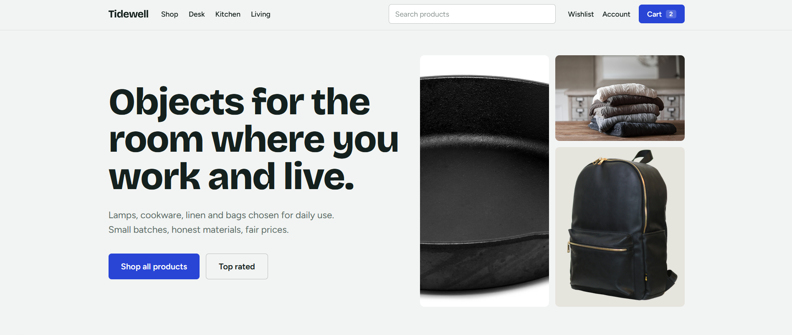

**Product catalogue and filters**

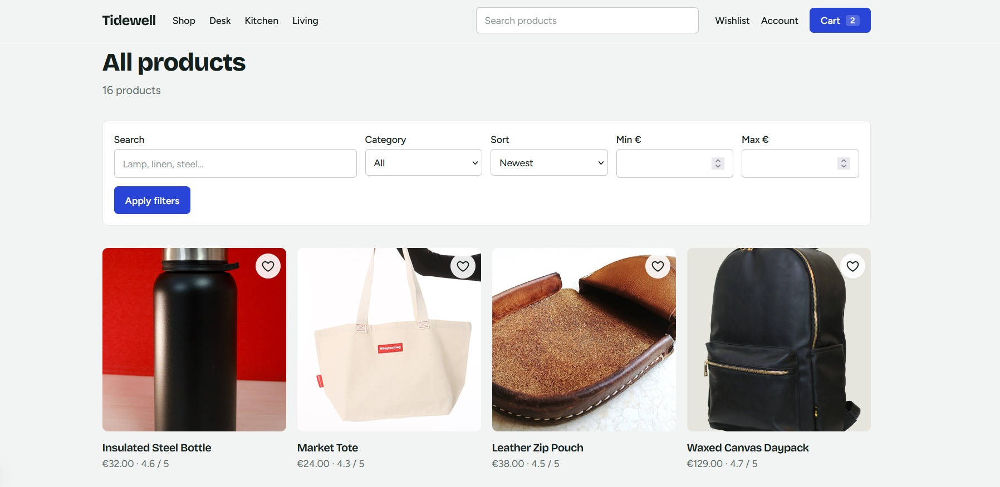

**Product details**

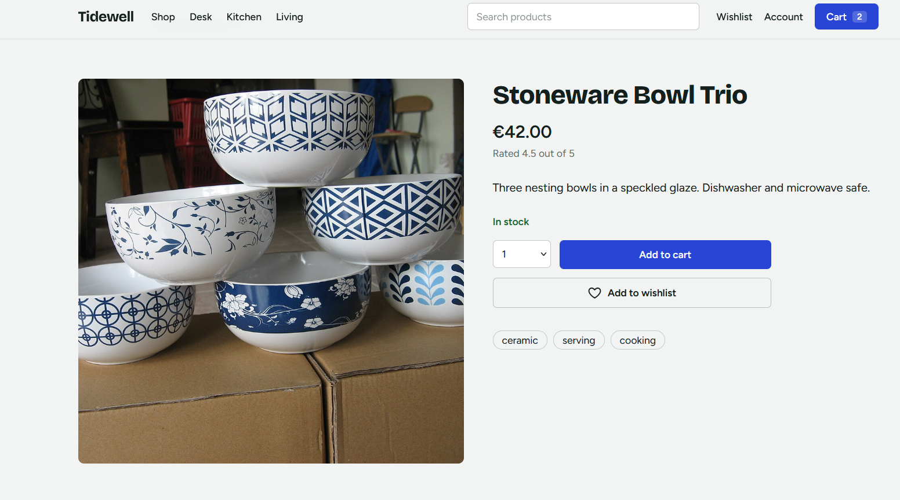

**Shopping cart**

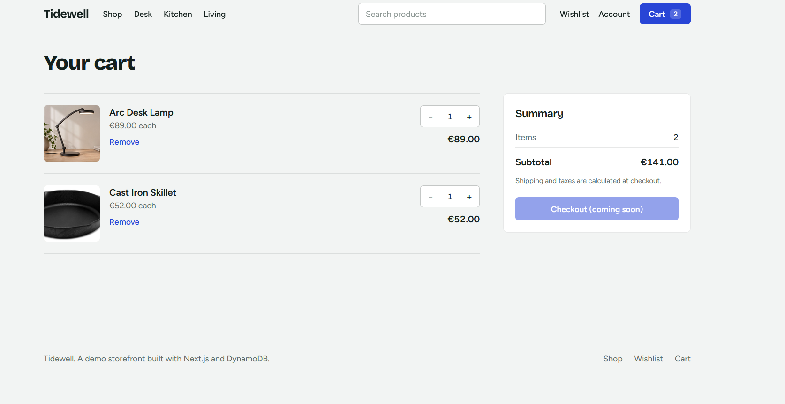

**Wishlist**

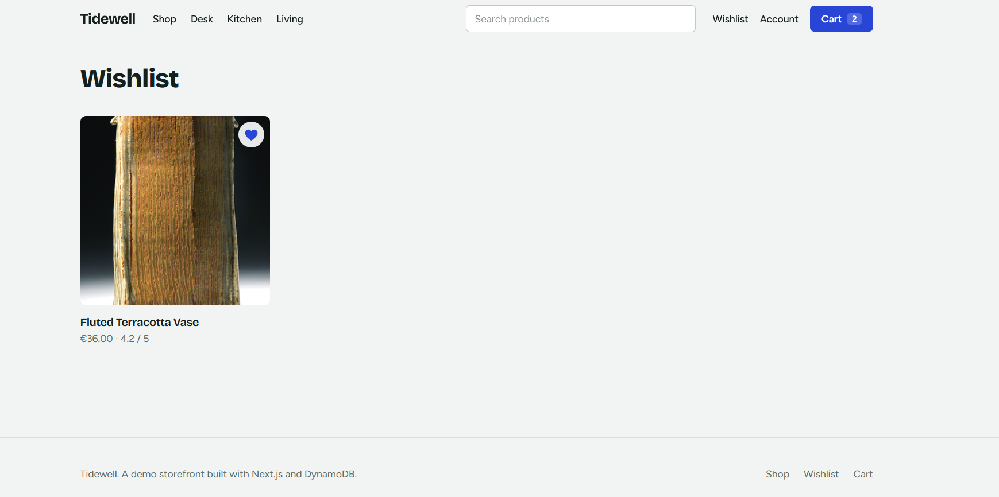

**Customer account**

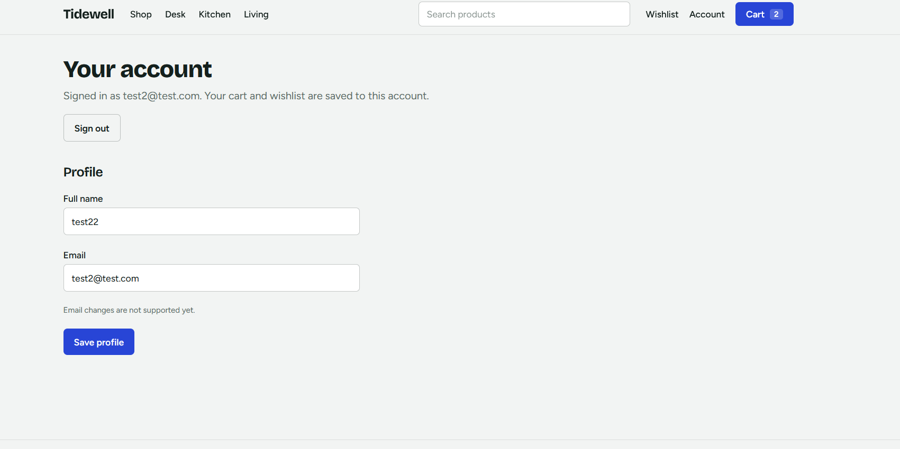

**Mobile layout**

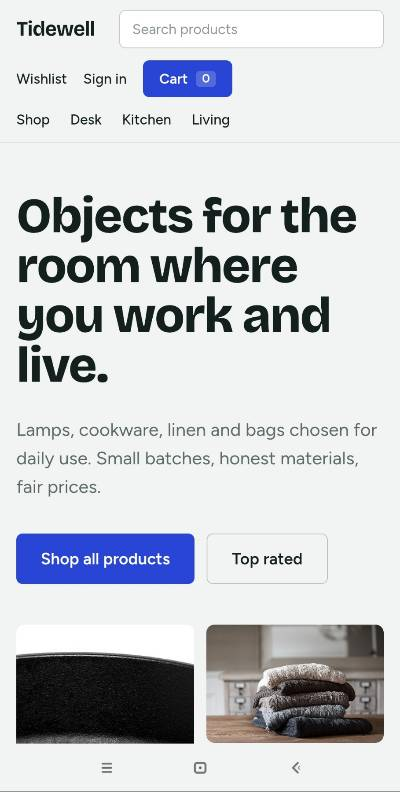

### Admin dashboard

**Dashboard overview**

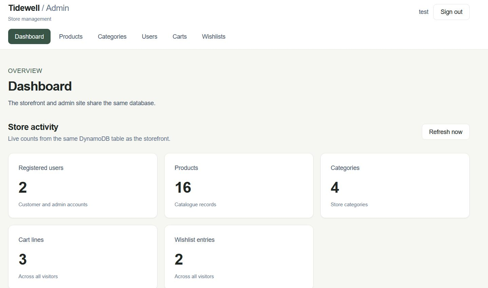

**Sales analytics**

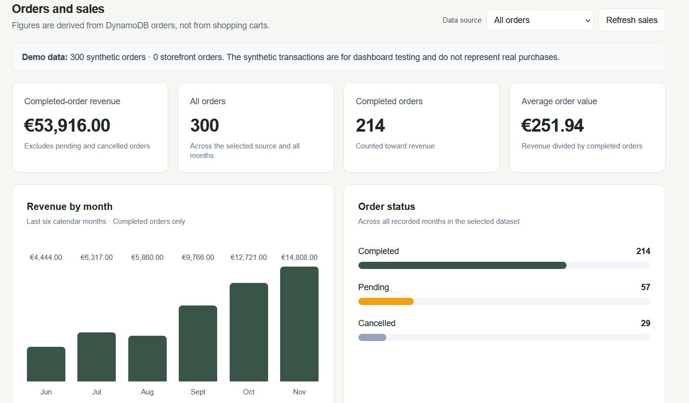

**Product management**


**Category management**

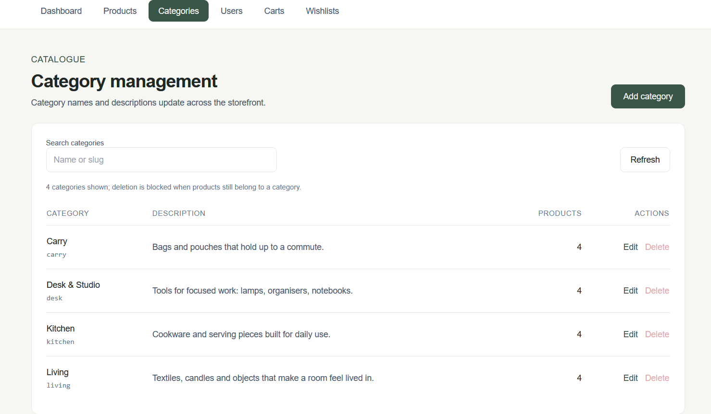

**User management**

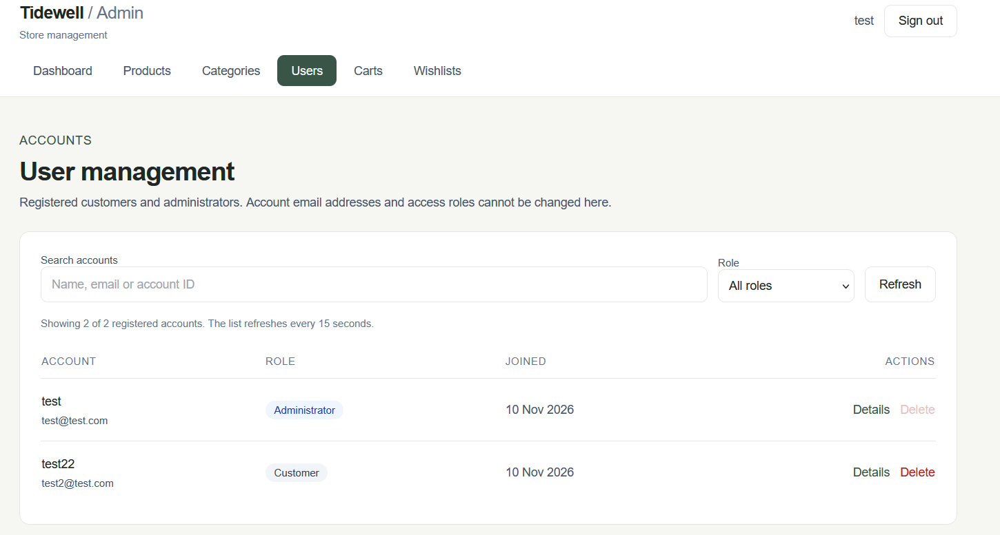

**Cart management**

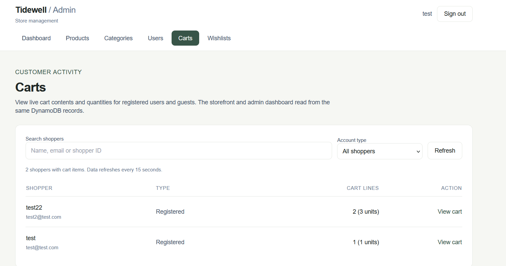

**Wishlist management**


## 14. Documentation, Images and Limitations

Further implementation details are available in:

- [Admin authorization and local setup](docs/ADMIN_STAGE1.md)
- [Synthetic orders and analytics](docs/ADMIN_STAGE2.md)
- [Product and category management](docs/ADMIN_STAGE3.md)
- [Users, carts and wishlists](docs/ADMIN_STAGE4.md)
- [Local DynamoDB setup](docs/LOCAL_DYNAMODB.md)
- [Authentication](docs/AUTHENTICATION.md), [rate limiting](docs/AUTH_RATE_LIMITING.md), [guest sessions](docs/GUEST_SESSION_SECURITY.md) and [cart consistency](docs/CART_CONSISTENCY.md)
- [Product images](docs/PRODUCT_IMAGES.md) and [image credits](docs/IMAGE_CREDITS.md)

Product photographs are illustrative sample images; they are not official listings from manufacturers. New product and category records store **image paths**, not uploaded image files. The corresponding images must exist in the storefront's `public/images/` directory.

The application is designed for a small local demonstration dataset. It does not provide real checkout, payments, shipping, inventory reservation, customer password recovery or production operations. Admin listings and analytics are not optimized for very large databases. It has **not been deployed or configured as a public production service**.
